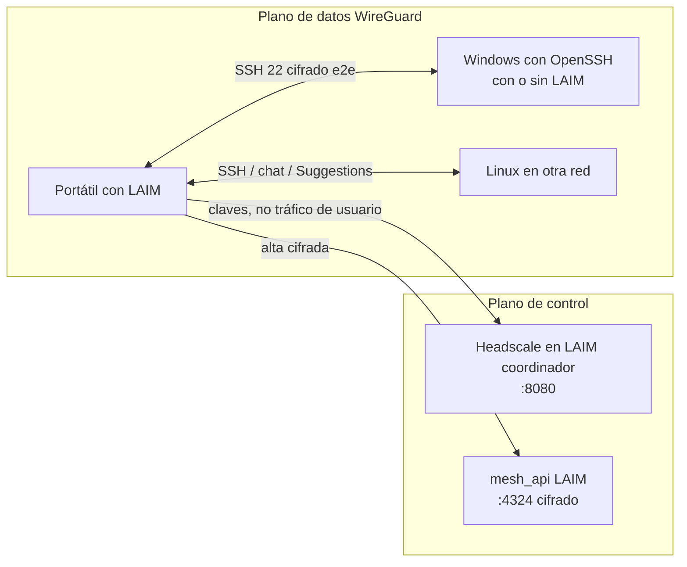

# Red Mesh WireGuard con Headscale

Este manual cubre el coordinador Headscale en LAIM, el alta cifrada (`mesh_api` **:4324**), el cliente Tailscale oficial y el SSH de chat / `laim remote` / Suggestions. Los bloques **Ejemplo.** son escenarios reales (nombres de lab: `tibet.house.loc`, `silicon.house.loc`).

## ¿Qué es Headscale?

**Headscale** es una implementación de código abierto del servidor de control de **Tailscale**, que a su vez está construido sobre el protocolo **WireGuard**. Permite crear una **red privada virtual de malla (mesh VPN)** en la que todos los equipos registrados se conectan directamente entre sí con cifrado de extremo a extremo, sin necesidad de abrir puertos en firewalls ni configurar reglas NAT complejas.

> **Nota de compatibilidad de plataforma:**
> - ✅ **Linux** — plataforma oficial y recomendada para el servidor Headscale.
> - ✅ **macOS** — compatible como servidor Headscale (binarios para darwin/amd64 y darwin/arm64 disponibles en GitHub Releases).
> - ❌ **Windows** — **no disponible como servidor Headscale**. A partir de la versión v0.22, Juanfont dejó de publicar binarios oficiales para Windows. Para usar Headscale desde un equipo Windows, las opciones son: WSL2 con Ubuntu, Docker Desktop, o delegar la gestión a un servidor Linux/Mac que ejecute LAIM.

---

## Visión: IA sobre SSH en cualquier red

LAIM usa el **mismo cliente Tailscale** (software de nodo de código abierto) tanto si el plano de control es **Headscale autohospedado** (un LAIM coordinador) como si es el **servicio comercial de Tailscale Inc.** El objetivo no es «tener VPN»: es que **chat**, **`laim remote`** y **Suggestions** hablen por SSH con el mismo contrato, aunque el destino:

- tenga o **no** tenga LAIM instalado;
- esté en **otra LAN**, 4G, hotel o VPC;
- sea Linux, macOS o Windows (OpenSSH).

La dirección estable es una IP de malla (`100.64.0.0/10`, a menudo `100.x`). `laim remote` y el selector de equipo del chat la usan cuando hay `tailscale_ip` **y** (`connection_mode=tailscale` **o** este host ya tiene una IP `100.x` local). Así University / un portátil ya unido llega a Windows/Linux aunque la ficha del equipo siga en `direct`.



**Ejemplo.** El Mac Silicon ya está en la malla (`tailscale ip -4` → `100.64.0.4`). El Windows `pc-lab` tiene `tailscale_ip=100.64.0.12` pero `connection_mode=direct`. Chat → Equipo destino `pc-lab` abre SSH a `100.64.0.12`, no a la IP LAN que cambió en el hotel. Si el Mac **no** estuviera en la malla, LAIM usaría `Host` / `HostIP` como siempre.

---

## Cómo funciona Tailscale (y por qué Headscale encaja)

Fuente: artículo *[How Tailscale works](https://tailscale.com/blog/how-tailscale-works)* (Avery Pennarun, Tailscale, 20 mar 2020). Las ilustraciones de esa página son de Ross Zurowski y **no se reproducen aquí**. Las figuras siguientes son **infografías originales LAIM** (estilo CRT) que cubren los mismos conceptos. WireGuard® es marca de Jason A. Donenfeld.

### Plano de datos: WireGuard, no un concentrador clásico

Una VPN tradicional es **estrella** (hub-and-spoke): todos los clientes mandan el tráfico a una pasarela. Eso es fácil de configurar, pero el camino es largo (Nueva York → San Francisco → Nueva York) y el hub es un cuello de botella.


*Fig. 1 — Todo el tráfico pasa por un único concentrador. El hub es sencillo de administrar y también el cuello de botella.*

Si dos equipos están en la misma ciudad, el camino sigue yendo al concentrador lejano y vuelve (**hairpin**): latencia extra y un punto único de fallo.


*Fig. 2(a) — Nueva York → San Francisco → Nueva York. El concentrador está lejos aunque origen y destino sean vecinos.*

Varios hubs de WireGuard acercan el tráfico, pero hay que **predefinir** cada túnel. Tailscale (y Headscale) evitan esa lista estática.


*Fig. 2(b) — El tramo local puede quedarse local, a costa de una malla de concentradores que alguien tiene que cablear a mano.*

WireGuard abre túneles **muy ligeros**. Tailscale los usa en **malla**: cada nodo habla con cada nodo. El cifrado es de extremo a extremo: la clave privada **no sale** del equipo.


*Fig. 3 — Cada par abre un túnel WireGuard directo. No hay concentrador de datos en el camino.*

### Plano de control: intercambio de claves (coordinación)

La malla necesita que cada nodo conozca las **claves públicas** y *dónde* están los demás (IP/puerto actuales). Eso no viaja por el túnel de usuario: viaja por un **servidor de coordinación** (drop-box de claves). En Tailscale Inc. es `login.tailscale.com`. En LAIM es **Headscale** en el coordinador (`:8080`).

El control es estrella; **los datos no**. El servidor de coordinación no descifra el tráfico WireGuard.


*Fig. 4 — Líneas discontinuas: claves y política (pocos bytes). Líneas sólidas: paquetes WireGuard entre nodos.*

Pasos (iguales con Headscale o con Tailscale.com):

1. El nodo genera un par de claves; la **privada nunca sale**.
2. Publica la pública y su ubicación actual en el coordinador.
3. Descarga las públicas de su dominio (usuario Headscale `laim`, o cola Tailscale).
4. Configura WireGuard con ese conjunto.

Identidad: Tailscale Inc. delega el login a OIDC/SAML (Google, Microsoft…). Headscale usa **usuarios/namespaces** locales (en LAIM, usuario `laim`) y **preauth keys** o el flujo cifrado `mesh_api`.


*Fig. 5 — Tailscale Inc. delega el login (OIDC/SAML). Headscale usa usuarios locales (`laim`) y claves de preauth o `mesh_api`.*

### NAT, STUN/ICE y relés DERP

En la vida real casi ningún portátil tiene IP pública ni puerto abierto. Tailscale usa **STUN/ICE** para atravesar NAT. Si UDP está bloqueado, el tráfico ya cifrado se **reléa** por DERP (HTTPS): el relé **no puede leer** el contenido.


*Fig. 6 — STUN/ICE taladra NAT en ambos lados. No hace falta uPnP ni un puerto de entrada.*


*Fig. 7 — Si UDP está bloqueado, DERP reenvía paquetes **ya cifrados**. El relé no tiene la clave privada.*

Headscale **no sustituye** DERP: los clientes Tailscale oficiales siguen usando la red DERP de Tailscale (o relés que configure el operador). El coordinador Headscale solo hace de **control plane**.

### ACL, auditoría y despliegue incremental

Las políticas viven en el coordinador y se **aplican en cada nodo** al descifrar. Se puede empezar con dos dispositivos e ir añadiendo servidores, Windows sin LAIM, y (opcional) **subnet routers** hacia una LAN heredada.


*Fig. 8 — Una política en el coordinador; el filtro de paquetes corre al descifrar en cada máquina. No hay firewall central como cuello de botella.*

---

## Headscale en LAIM frente a Tailscale.com

| | **Headscale (LAIM coordinador)** | **Tailscale Inc. (nube)** |
|--|----------------------------------|---------------------------|
| Quién opera el control | Vosotros (binario Headscale en Linux/macOS LAIM) | Tailscale, Inc. |
| Cliente en el nodo | Mismo `tailscale` oficial | Mismo cliente |
| Login | `--login-server http(s)://host:8080` + preauth / mesh_api | `controlplane.tailscale.com` + cuenta |
| Alta entre dos LAIM | Inbox cifrada `mesh_api` **:4324** (`KeyMeshEnrollment`) | Consola Tailscale / auth keys de ellos |
| Datos | WireGuard e2e en ambos casos | Igual |
| Cumplimiento | Claves y nodos en vuestra red | Confianza en el SaaS |

**Alineación:** no mezclar en el mismo daemon un login-server Headscale y la cola de Tailscale.com. **Aplicar unión** en LAIM usa `--force-reauth` si el cliente ya apuntaba a otro control plane.

**Nodos conectados** en el coordinador = `headscale nodes list` (plano WireGuard, IP `100.x`). **No** es el ACK de `mesh_api` (`validated`). Sin IP `100.x` el nodo no está en la malla aunque la solicitud esté aprobada.

**Ejemplo.** En Silicon pulsas **Solicitar unirse** → en tibet el admin da ✅. El inbox marca *aprobada* / `validated` tras el ACK. Hasta que Silicon pulse **Aplicar unión** y Headscale liste el nodo con `100.64.0.4`, el chat SSH a Silicon **no** tiene camino de malla.

---

## Equipos con LAIM y sin LAIM

| Destino | Cómo entra en la malla | Cómo usa LAIM la IA |
|---------|------------------------|---------------------|
| Otro LAIM (cliente) | Config › mesh › Cliente Tailscale › Solicitar unirse → coordinador aprueba → **Aplicar unión** | Chat con selector de equipo; `laim remote`; Suggestions |
| Windows/Linux/macOS **sin** LAIM | Cliente Tailscale + `tailscale up --login-server … --authkey …` (clave 24 h en el coordinador) | Registrar el equipo en **Equipos** con IP `100.x` y SSH; chat/`laim remote` igual |
| Coordinador | Headscale + opcionalmente el **mismo host** como cliente/nodo | Inferencia local; F6 en Connect sigue en el execution host |

Windows destino: OpenSSH (manual *Configurar Windows para laim remote*). La malla **no** abre el 22 por magia: hace falta `sshd` y la regla de firewall (perfil **Any**).

**Ejemplo.** Un Windows de laboratorio **sin** LAIM: el admin genera preauth 24 h en tibet; en el PC `tailscale up --login-server http://tibet.house.loc:8080 --authkey hskey-auth-…`. En Equipos se registra host, usuario SSH y `tailscale_ip`. Suggestions «cuánta RAM hay» corre `remotesystem` por `100.x`, igual que un nodo con LAIM.

---

## Chat y Suggestions sobre la malla

1. **Sincronizar IPs** rellena `tailscale_ip` (`100.x`) en la ficha del equipo.
2. SSH usa esa IP si `connection_mode=tailscale` **o** si **este** host ya está en la malla (`tailscale ip -4`). No hace falta marcar `tailscale` en cada Computer para University / internet-only.
3. **Chat:** selector de equipo → preguntas de sistema → `remotesystem` por SSH a `100.x` (no a la IP LAN que cambió).
4. **`laim remote`:** la misma ficha; Suggestions usa los mismos orquestadores que el chat (inventario, red, procesos).
5. El **ACK** `validated` no basta: hace falta fila en **Nodos conectados** y ping/SSH a `100.x`.

**Ejemplo.** Equipo destino `tibet`, pregunta «¿cuánto disco libre hay?». F6 no corre en el Mac que abre el chat: corre por SSH en Ubuntu. La ruta IA (Localhost vs Share) es independiente: la GPU puede estar en tibet y el disco medido también, o la GPU en Silicon y el disco en tibet.

---


## Para qué se puede usar

Headscale integrado en LAIM te permite:

- **Gestionar equipos remotos sobre WireGuard**: todos los equipos (servidores, portatiles, contenedores) comparten una red privada con IPs del rango `100.64.x.x`, accesibles desde cualquier lugar aunque estén detrás de NAT.
- **Conectar los ordenadores de LAIM (`laim remote`) sin configurar reglas de firewall ni VPN corporativa**: alta cifrada entre dos LAIM (`mesh_api` :4324) o preauth + `tailscale up` en nodos sin LAIM.
- **Establecer terminales SSH remotas dentro de LAIM** usando las IPs de Tailscale en lugar de IPs públicas (más seguro).
- **Mantener conectividad NAT traversal automática**: WireGuard atraviesa CGN, firewalls empresariales y conexiones 4G/5G sin configuración adicional.
- **Revocar acceso instantáneamente** desde LAIM sin tocar reglas de firewall.

### Casos de uso típicos

| Escenario | Descripción |
|-----------|-------------|
| Equipo remoto en red de cliente | Registra el servidor del cliente en la malla; gestíona vía `laim remote` con IP Tailscale `100.64.x.x` |
| Equipo portatil fuera de la oficina | El portátil se registra una vez; LAIM lo ve siempre en la misma IP de la malla |
| Servidor en la nube (AWS, VPS) | Sin necesidad de abrir puertos SSH en la nube; solo el puerto Headscale (8080) necesita estar accesible |
| Test de servicios internos | Conecta contenedores o VMs a la malla para pruebas de red sin expoción pública |
| Acceso web LAIM remoto | Un administrador puede acceder a `http://100.64.x.x:4321` desde cualquier lugar |
| Windows/Linux **sin** LAIM | Cliente Tailscale + OpenSSH; se registra en Equipos con IP `100.x`; chat y Suggestions igual |
| IA en `laim remote` | Suggestions sobre la sesión SSH usa las mismas inferencias que el chat (orquestadores Go) |

**Ejemplo.** Desde un hotel (4G) el Mac Silicon pide en chat el inventario del servidor tibet. Tailscale ya está «conectado» (icono de menú). SSH va a `100.64.0.1`. No hace falta VPN corporativa ni abrir el 22 a Internet.

---

## Diferencias entre Linux, macOS y Windows

| Característica | Linux | macOS | Windows |
|-----------|-------|-------|---------|
| **Servidor Headscale** | ✅ Nativo, recomendado | ✅ Compatible (darwin binaries) | ❌ No disponible (desde v0.22) |
| **Cliente Tailscale** | ✅ `apt` / `dnf` / `install.sh` | ✅ **`.pkg` / `Tailscale.app`** (CLI de la app) | ✅ Store / MSI / winget |
| **Integración con LAIM** | ✅ Completa | ✅ Completa | ⚠️ Solo como cliente (no puede alojar Headscale) |
| **Descarga desde LAIM** | ✅ Automática | ✅ Automática (`.pkg` oficial) | ✅ MSI silencioso (`TS_UNATTENDEDMODE=always`) |
| **Unión desde la UI** | ✅ Modal (instalar + solicitar) | ✅ CLI de `Tailscale.app` (sin sudo) | ✅ MSI + solicitar / aplicar |

En macOS, **Aplicar unión** llama al CLI de `/Applications/Tailscale.app` (no al binario Homebrew, que no habla con el daemon de la app). Linux puede usar `sudo -S` para `tailscale up`; macOS **no** debe envolver el CLI de la app en sudo.

### Particularidades de macOS

En macOS, el servidor Headscale puede alojarse igual que en Linux. El socket Unix vive en la carpeta de datos de LAIM (`headscale_data/headscale.sock`) en lugar de `/var/run/`. El cliente de nodo es **`Tailscale.app`** (paquete standalone). Homebrew es un *fallback* si falla el `.pkg`, no el camino recomendado. La App Store (`IPNExtension`) no es el cliente que usa LAIM.

---

## Instalación

### Prerequisitos

1. LAIM instalado. El **coordinador** (Headscale) corre en Linux o macOS. Los **clientes** pueden ser Linux, macOS o Windows.
2. Puerto **8080/tcp** (Headscale, plano de control) alcanzable por los nodos que hacen `tailscale up`.
3. Puerto **`mesh_api` 4324/tcp** en el coordinador (`laim web` + interruptor **Este LAIM es el coordinador de la malla**). Headscale `:8080` **no** abre el 4324.
4. Firewall del SO: regla **LAIM mesh_api** (Internal › Local → Reparar) además de TCP 8080 si hay uniones desde otra red.
5. En cada nodo: cliente **Tailscale** oficial (ver instalación). En Windows destino, OpenSSH (Ayuda › Configurar Windows).

No confundir puertos:

| Servicio | Puerto | Rol |
|----------|--------|-----|
| API web local | 4320 | Loopback |
| UI Reflex | 4321 | Loopback |
| `share_api` | 4322 | Share / Connect (no es el alta de malla) |
| `mesh_api` | **4324** | Alta cifrada (`KeyMeshEnrollment`) |
| Headscale | **8080** | Plano de control Tailscale |
| WireGuard / Tailscale | UDP 41641 | Plano de datos (cuando aplica) |

### Descarga automática desde LAIM

LAIM descarga automáticamente el último binario de Headscale desde [GitHub Releases](https://github.com/juanfont/headscale/releases):

1. Abre **Configuración › Gestión de equipos remotos › Red mesh WireGuard (Headscale)**.
2. Haz clic en **Descargar Headscale**.
3. LAIM detecta tu arquitectura (amd64, arm64, etc.) y descarga el binario correcto.
4. El binario se guarda en `<directorio_laim>/headscale` (junto al ejecutable `laim`).

> Si prefieres instalarlo manualmente: descarga el binario de [https://github.com/juanfont/headscale/releases](https://github.com/juanfont/headscale/releases) para tu plataforma y cópialo al directorio de LAIM (`bin/linux/`, `bin/mac/`) con nombre `headscale`. Dale permisos de ejecución: `chmod +x headscale`.

### Instalación manual de Tailscale en los equipos clientes

Cada equipo que quieras registrar en la malla necesita **Tailscale** instalado. A continuación se describen los pasos completos para cada plataforma.

---

#### Linux (Ubuntu / Debian)

```bash
curl -fsSL https://tailscale.com/install.sh | sh
sudo systemctl enable --now tailscaled
```

#### Linux (Red Hat / Fedora / Rocky)

```bash
sudo dnf install tailscale
sudo systemctl enable --now tailscaled
```

#### Linux (Arch)

```bash
sudo pacman -S tailscale
sudo systemctl enable --now tailscaled
```

---

#### macOS — recomendado: `Tailscale.app` (el mismo que usa LAIM)

LAIM instala el **paquete oficial standalone** (Config › Red mesh › **Cliente Tailscale** › Instalar → `Tailscale-latest-macos.pkg`). El CLI correcto es:

```
/Applications/Tailscale.app/Contents/MacOS/Tailscale
```

**No** uses el binario de Homebrew ni `sudo` alrededor de ese CLI: no habla con el daemon de la app y macOS pide el permiso VPN en la GUI.

> **App Store:** si solo tienes Tailscale de la App Store (`IPNExtension`), desinstálala o ciérrala. Homebrew es un *fallback* si falla el `.pkg`, no el camino recomendado.

A mano:

```bash
# Descarga el instalador oficial:
curl -O https://pkgs.tailscale.com/stable/Tailscale-latest-macos.pkg
open Tailscale-latest-macos.pkg
open -a Tailscale   # icono en la barra de menú; acepta el perfil VPN
```

Unión **con LAIM:** Solicitar unirse → el admin Aprueba → **Aplicar unión** (sin sudo).

Unión **sin LAIM** (preauth del administrador):

```bash
/Applications/Tailscale.app/Contents/MacOS/Tailscale up \
  --login-server http://<IP_O_FQDN_SERVIDOR>:8080 \
  --accept-routes \
  --hostname=<nombre-de-tu-mac> \
  --authkey=<preauth_key>
```

Estado:

```bash
/Applications/Tailscale.app/Contents/MacOS/Tailscale status
```

#### macOS — fallback: Homebrew (solo si el `.pkg` falla)

```bash
brew install tailscale
```

Ese binario **no** es el que usa LAIM con `Tailscale.app`. Si mezclas ambos, **Aplicar unión** fallará (`Sorry, try again` o un daemon distinto). Prefiere desinstalar Homebrew Tailscale y usar el `.pkg`.

#### Windows (PowerShell como administrador)

```powershell
winget install Tailscale.Tailscale
# Después de instalar, Tailscale aparece en la bandeja del sistema.
# Para conectar via CLI (PowerShell administrador):
tailscale up --login-server http://<IP_SERVIDOR>:8080 --authkey <preauth_key>
```

> **Nota Windows:** Tailscale en Windows requiere ejecutar la aplicación con privilegios de administrador la primera vez. El ícono aparece en la bandeja del sistema.

---

#### Errores comunes de instalación

| Error | Causa | Solución |
|-------|-------|----------|
| `command not found: tailscale` | Tailscale no instalado o PATH incorrecto | Linux: `install.sh`. macOS: CLI de `Tailscale.app`. Windows: MSI |
| `Sorry, try again` / sudo en Mac | `sudo` alrededor del CLI de `Tailscale.app` | Quita sudo; acepta el permiso VPN en la GUI |
| `tailscale up` no responde | Daemon no está corriendo | Linux: `sudo systemctl start tailscaled`. macOS: abre `Tailscale.app` |
| `connection refused` al daemon (Mac) | Homebrew `tailscaled` vs app | Usa solo `Tailscale.app`; no mezcles `brew services` |
| `invalid authkey` | La preauth key expiró (validez 24 h) | Genera una nueva desde LAIM (o Aprobar de nuevo) |
| `login server not reachable` | Headscale no es accesible | `curl http://<IP>:8080/health` |
| *Connection refused* :4324 | `mesh_api` parado | `laim web` + interruptor coordinador + firewall 4324 |

---

## Configuración desde LAIM

### 1. Configurar el servidor Headscale

1. Ve a **Configuración › Gestión de equipos remotos › Red mesh WireGuard (Headscale)**.
2. Haz clic en **Configurar servidor Headscale**.
3. Introduce la **URL del servidor** (la URL que usarán los equipos remotos para conectarse):
   - LAN: `http://192.168.0.198:8080` (IP local del servidor LAIM)
   - Internet: `http://mi-servidor.ejemplo.com:8080` (FQDN o IP pública)
   - HTTPS recomendado en internet: `https://mi-servidor.ejemplo.com:8080`
4. Introduce el **puerto** (por defecto: `8080`).
5. LAIM genera el archivo `config.yaml` en `<directorio_laim>/headscale_data/config.yaml`.

**Ejemplo de URL del servidor** (entorno de prueba en `tibet.house.loc`):
```
http://192.168.0.198:8080
```

### 2. Arrancar el servidor

1. Haz clic en **Arrancar servidor Headscale**.
2. LAIM lanza Headscale en segundo plano y espera a que esté disponible.
3. Automáticamente:
   - Crea una **API key** de administración y la guarda cifrada en `laim.dat`.
   - Crea el usuario **`laim`** en Headscale (namespace de la malla).
4. El panel muestra el estado **● Ejecutándose** con la versión instalada.

> El servidor Headscale se inicia como un proceso en segundo plano gestionado por LAIM. El PID se guarda en `headscale_data/headscale.pid` y los logs en `headscale_data/headscale.log`.

6. Activa **Este LAIM es el coordinador de la malla** para que `mesh_api` escuche en **4324**. Abre el firewall (**LAIM mesh_api**). Deja `laim web` en marcha; si no, las solicitudes de unión dan *connection refused*.

**Ejemplo.** En tibet: Descargar Headscale → Configurar `http://tibet.house.loc:8080` → Arrancar → interruptor coordinador ON. Desde Silicon, `curl -v http://tibet.house.loc:4324` debe conectar (aunque el cuerpo vaya cifrado). `curl http://tibet.house.loc:8080/health` comprueba Headscale, no el enrollment.

### 3. Registrar un equipo en la malla

Hay **dos caminos**.

#### A — Cliente LAIM (recomendado)

En el equipo que se une (p. ej. Silicon):

1. **Configuración › Equipos remotos › Red mesh › Cliente Tailscale (este equipo)**.
2. **Instalar** si falta (modal de progreso). Linux `install.sh`; macOS `.pkg`; Windows MSI.
3. URL del coordinador `http://tibet.house.loc:4324` → **Solicitar unirse**. El POST va cifrado con **`KeyMeshEnrollment`** (no la clave del traductor ni Share).
4. En el coordinador: **Solicitudes de unión** ✅ / ❌ / ⏸ / ▶️. Tras decidir, el operador del cliente pulsa **Actualizar estado** y **Aplicar unión**. No pegues preauth por chat.
5. **Aplicar unión** ejecuta `tailscale up` contra Headscale `:8080` con la clave de un solo uso. Si el enrollment ya está `validated`, **no** relanza `up`: comprueba la IP `100.x` viva. Sin `100.x` → el admin **Aprueba de nuevo** (clave nueva) y el cliente vuelve a Aplicar. Si el daemon ya apuntaba a Tailscale.com, LAIM reintenta con `--force-reauth`.
6. Coordinador: **Nodos conectados → Actualizar** (`headscale nodes list`). Luego **Sincronizar IPs**.

El coordinador puede unirse también como nodo. No pulses **Solicitar unirse** otra vez si ya hay una solicitud *aprobada*: se reutiliza el `request_id`. **Aplicar unión** recupera la hermana aprobada del mismo hostname.

**Ejemplo.** Primera unión Silicon→tibet: Solicitar → ✅ → Aplicar → `tailscale status` muestra `100.64.0.4` y el nodo `tibet`. Segunda vez (ya `validated`): Aplicar solo verifica; no vuelve a pedir VPN.

#### B — Preauth clásica (nodos sin LAIM)

1. En el coordinador, **Registrar equipo** / **Obtener clave de registro** (caducidad 24 h).
2. En el destino:

```bash
# Linux
sudo tailscale up --login-server http://<IP_SERVIDOR>:8080 --authkey <preauth_key>

# macOS (CLI de Tailscale.app, sin sudo)
/Applications/Tailscale.app/Contents/MacOS/Tailscale up \
  --login-server http://<IP_SERVIDOR>:8080 --authkey <preauth_key>

# Windows (PowerShell administrador)
tailscale up --login-server http://<IP_SERVIDOR>:8080 --authkey <preauth_key>
```

Ejemplo con el lab:

```bash
sudo tailscale up --login-server http://192.168.0.198:8080 --authkey hskey-auth-XXXX...
```

3. **Sincronizar IPs** en LAIM para copiar `100.64.x.x` a las fichas de **Equipos**.
4. Windows: activa OpenSSH primero (Ayuda › Configurar Windows). Firewall TCP 22 perfil **Any**. Claves de Administrators: `C:\ProgramData\ssh\administrators_authorized_keys`.

### 4. Verificar la conexión

En el equipo cliente, comprueba el estado de Tailscale:

```bash
tailscale status
```

Salida de ejemplo:
```
100.64.0.1  tibet         laim        linux   idle
100.64.0.2  mi-portatil   laim        windows active; direct 192.168.0.X:41641
```

Desde cualquier equipo de la malla, puedes hacer ping a otros por su IP de Tailscale:
```bash
ping 100.64.0.2
```

---

## Todas las opciones de configuración

El archivo `config.yaml` generado por LAIM cubre las opciones más comunes. A continuación se describen todas:

### URL del servidor (`server_url`)
La URL pública completa que los clientes Tailscale usan para contactar con el servidor de control. Debe ser accesible desde todos los equipos remotos.

```yaml
server_url: http://192.168.0.198:8080
# o con HTTPS:
server_url: https://mi-servidor.ejemplo.com:8080
```

> Para uso en internet, se recomienda HTTPS con un certificado válido (Let's Encrypt). El puerto puede ser cualquiera (443 es el más cómodo).

### Dirección de escucha (`listen_addr`)
Dónde escucha Headscale en el servidor. `0.0.0.0:8080` acepta conexiones de todas las interfaces.

```yaml
listen_addr: 0.0.0.0:8080
```

### Métricas Prometheus (`metrics_listen_addr`)
Para exponer métricas en un endpoint Prometheus. Dejar vacío para deshabilitar.

```yaml
metrics_listen_addr: ""          # deshabilitado
metrics_listen_addr: "0.0.0.0:9090"  # habilitado
```

### Claves privadas
Headscale genera automáticamente estas claves la primera vez que arranca. No es necesario configurarlas manualmente.

```yaml
noise:
  private_key_path: /ruta/headscale_data/noise_private.key
private_key_path: /ruta/headscale_data/private.key
```

### Base de datos
Headscale usa SQLite por defecto. Para entornos de producción con muchos nodos, se puede usar PostgreSQL.

```yaml
database:
  type: sqlite
  sqlite:
    path: /ruta/headscale_data/db.sqlite

# O PostgreSQL:
database:
  type: postgres
  postgres:
    host: localhost
    port: 5432
    name: headscale
    user: headscale
    pass: contraseña
```

### Rangos de IPs de la malla (`prefixes`)
Define el rango de IPs que Headscale asigna a los nodos. El rango por defecto es compatible con Tailscale.

```yaml
prefixes:
  v4: 100.64.0.0/10   # IPv4: 100.64.0.0 a 100.127.255.255
  v6: fd7a:115c:a1e0::/48  # IPv6
  allocation: sequential   # o "random"
```

### DNS (Magic DNS)
Por defecto LAIM deshabilita Magic DNS para simplificar la configuración. Se puede habilitar para resolver equipos por nombre.

```yaml
dns:
  magic_dns: false          # true para resolver nombres como "servidor1.laim.local"
  base_domain: laim.local
  nameservers:
    global:
      - 8.8.8.8
      - 1.1.1.1
  override_local_dns: false
```

### DERP (relay para NAT traversal)
DERP son servidores de relay que Tailscale usa cuando la conexión directa WireGuard no es posible (NAT estricto, firewall sin UDP). Por defecto LAIM usa los relays públicos de Tailscale.

```yaml
derp:
  server:
    enabled: false          # true para alojar tu propio relay DERP
  urls:
    - https://controlplane.tailscale.com/derpmap/default  # relays públicos
  auto_update_enabled: true
  update_frequency: 24h
```

Para máxima privacidad, puedes deshabilitar los relays públicos y alojar el tuyo propio.

### Nodos efímeros
Los nodos efímeros se eliminan automáticamente después de un periodo de inactividad.

```yaml
node:
  ephemeral:
    inactivity_timeout: 30m   # "0s" para deshabilitar la eliminación automática
```

---

## Verificación y diagnóstico

### Verificaciones automáticas de LAIM

Cada vez que se carga el panel **Red mesh WireGuard (Headscale)**, LAIM ejecuta una batería de comprobaciones automáticas y muestra el resultado directamente en la interfaz:

| Verificación | Qué comprueba | Resultado si falla |
|--------------|--------------|-------------------|
| **Servidor Headscale** | Si el proceso Headscale está activo | Muestra ○ Detenido; propone arrancar |
| **Cliente Tailscale instalado** | Si existe el CLI oficial (`tailscale` o `Tailscale.app`) | Tarjeta naranja con Instalar / comando |
| **Este servidor en la malla** | Si la máquina tiene una IP `100.64.x.x` asignada | Tarjeta naranja: Aplicar unión o `tailscale up` |
| **URL del servidor** | Si `server_url` tiene formato válido (sin guiones en IPs) | Error al guardar con la corrección sugerida |

#### ⚠️ Por qué el servidor Headscale también necesita el cliente Tailscale

Headscale es el **servidor de coordinación** (plano de control). El **cliente Tailscale** es el componente que establece el túnel WireGuard real (plano de datos). Sin el cliente instalado y registrado en la malla, el servidor Headscale puede coordinar otros equipos pero **no puede enrutar tráfico** hacia ellos:

```
Sin cliente Tailscale en el servidor:
  LAIM en Linux → intenta conectar a 100.64.0.1:22
  Sistema operativo: sin ruta para 100.64.x.x → i/o timeout ✖

Con cliente Tailscale instalado y registrado:
  LAIM en Linux → 100.64.0.1:22
  Sistema operativo: ruta via tailscale0 → túnel WireGuard → Mac:22 ✓
```

Cuando LAIM detecta que el cliente Tailscale no está instalado o no está en la malla, muestra una **tarjeta de advertencia naranja** con el comando exacto para corregirlo, adaptado a la plataforma (Linux o macOS).

### Desde LAIM (panel web)

En el panel **Red mesh WireGuard (Headscale)**:

| Indicador | Descripción |
|-----------|-------------|
| **Estado** | ● Ejecutándose / ○ Detenido |
| **Versión** | Versión de Headscale instalada |
| **Servidor** | URL pública del servidor Headscale |
| **✅ Cliente Tailscale instalado · IP en malla: 100.64.x.x** | Verificación automática: cliente instalado y registrado |
| **Nodos** | Lista de equipos registrados con su IP Tailscale |
| **Sincronizar IPs** | Actualiza las IPs de Tailscale en `laim remote` |

### Desde la línea de comandos (Linux/macOS)

```bash
# Ver nodos registrados
./headscale --config headscale_data/config.yaml nodes list

# Ver usuarios
./headscale --config headscale_data/config.yaml users list

# Ver preauth keys activas
./headscale --config headscale_data/config.yaml preauthkeys list -u 1

# Ver logs de Headscale
tail -f headscale_data/headscale.log

# Health check del servidor
curl http://127.0.0.1:8080/health
# Respuesta esperada: {"status":"pass"}

# Ver estado de Tailscale en un equipo cliente
tailscale status
tailscale ping 100.64.0.X
```

### Verificación del health check

Si Headscale está correctamente iniciado:

```bash
curl http://127.0.0.1:8080/health
```

Respuesta esperada:
```json
{"status":"pass"}
```

### Errores comunes de conexión SSH vía Tailscale

| Error | Causa | Solución |
|-------|-------|-----------|
| `dial tcp 100.64.x.x:22: i/o timeout` | SSH no está activo en el equipo destino | Activar **Remote Login** en macOS o instalar `openssh-server` en Linux |
| `dial tcp 100.64.x.x:22: connection refused` | SSH instalado pero detenido | `sudo systemctl start ssh` (Linux) / `sudo systemsetup -setremotelogin on` (macOS) |
| `no tiene credenciales configuradas` | El equipo no tiene contraseña ni clave RSA en LAIM | Editar el equipo en **Configuración › Gestión de equipos remotos › Equipos** y guardar credenciales |
| `authentication failed` | Credenciales incorrectas en LAIM | Verificar usuario y contraseña/clave RSA en la ficha del equipo |
| `no route to host` | La IP Tailscale no es alcanzable | Ejecutar `tailscale ping 100.64.x.x` en ambos equipos; reconectar si falla |

**Activar SSH en macOS** (paso previo obligatorio para acceso remoto):
```bash
# Verificar estado actual
sudo systemsetup -getremotelogin

# Activar
sudo systemsetup -setremotelogin on

# O desde Ajustes del Sistema: General › Compartir › Sesión Remota → activar
```

---

## Sección para administradores

### Flujo completo de alta de un equipo

#### 0. Requisito previo — activar SSH en el equipo de destino

Antes de registrar un equipo en la malla, asegúrate de que tiene el **servidor SSH activo**. Sin él, la conexión llegará vía Tailscale pero fallará con `i/o timeout` en el puerto 22.

**macOS** — activar Sesión Remota (Remote Login):
```bash
# Opción 1: desde terminal
sudo systemsetup -setremotelogin on

# Opción 2: desde la interfaz gráfica
# Ajustes del Sistema › General › Compartir › Sesión Remota → activar
```

**Linux** — instalar y activar OpenSSH server:
```bash
sudo apt install openssh-server   # Debian/Ubuntu
sudo systemctl enable --now ssh
```

**Verificación** (desde cualquier equipo de la malla):
```bash
# Sustituye la IP por la IP Tailscale del equipo destino (100.64.x.x)
nc -zv 100.64.0.X 22
# Resultado esperado: succeeded / open
```

> Si el resultado es `i/o timeout` (no `connection refused`), el equipo es alcanzable en la malla pero el puerto 22 está cerrado — activa el servidor SSH según las instrucciones anteriores.
> Si el resultado es `connection refused`, el servidor SSH está instalado pero detenido — arráncalo con `systemctl start ssh` (Linux) o `sudo systemsetup -setremotelogin on` (macOS).

---

#### 1. Registrar el equipo en la malla Tailscale

1. **En LAIM (panel web)**: ve a **Configuración › Red mesh WireGuard (Headscale) › Generar preauth key** y genera una clave para el usuario `laim`.
2. **En el equipo remoto**: instala Tailscale (ver sección [Instalación](#instalación)) y regístralo:
   ```bash
   sudo tailscale up --login-server http://<IP_HEADSCALE>:8080 --authkey hskey-auth-XXXX
   ```
3. **En LAIM**: ve a **Ver nodos** — el nuevo equipo aparecerá en la lista con su IP `100.64.x.x`.

#### 2. Importar el nodo como equipo LAIM

4. En la pantalla **Ver nodos**, pulsa el botón **"⮞ Importar nodos como equipos LAIM"**.
   - LAIM crea automáticamente un registro de equipo en **Gestión de equipos** con `ConnectionMode=tailscale` y la IP Tailscale asignada.
   - El nombre del equipo se toma del nombre que Headscale asignó al nodo (`given_name`).

> **⚠️ Importante — credenciales SSH:** Los equipos importados automáticamente **no tienen credenciales SSH configuradas**. El registro se crea con la IP de Tailscale pero sin usuario remoto ni contraseña/clave RSA. Si intentas abrir una sesión SSH sin configurarlas, recibirás el error:
> ```
> ✖️ equipo «<nombre>» no tiene credenciales configuradas (clave RSA ni contraseña)
> ```

#### 3. Configurar credenciales SSH del equipo importado

5. Ve a **Configuración › Gestión de equipos remotos › Equipos**.
6. Busca el equipo importado (tendrá el badge `◎ Tailscale`) y pulsa el icono de editar ✏️.
7. Rellena los campos:
   - **Usuario remoto**: el usuario SSH del equipo (p. ej. `perico`, `ubuntu`, `pi`).
   - **Contraseña** o **Clave RSA**: las credenciales para autenticarte en ese equipo.
8. Guarda los cambios.

#### 4. Añadir el equipo a grupos (opcional)

9. Ve a **Configuración › Gestión de equipos remotos › Grupos de equipos**.
10. Edita el grupo que corresponda y añade el nuevo equipo a la lista de miembros.

#### 5. Otorgar acceso a usuarios no administradores

11. Ve a **Configuración › Gestión de equipos remotos › Acceso de usuarios a equipos**.
12. Selecciona el usuario en el desplegable.
13. Marca la casilla del equipo Tailscale importado (aparecerá con el prefijo `◎` en su nombre).
14. Pulsa **"Guardar acceso"**.

> **Nota:** Los usuarios con rol **admin** ven automáticamente todos los equipos; no necesitan que se les otorgue acceso explícitamente. Solo los usuarios con rol **user** requieren este paso.

A partir de este momento, el usuario podrá ver y conectarse al equipo desde **Acceso remoto SSH** (LAIM Remote), y la conexión se establecerá a través del túinel WireGuard mesh de forma transparente.

### Revocar acceso de un equipo

```bash
# Listar nodos con sus IDs
./headscale --config headscale_data/config.yaml nodes list

# Eliminar nodo por ID
./headscale --config headscale_data/config.yaml nodes delete --identifier <ID>
```

Después de eliminar el nodo, haz clic en **Sincronizar IPs** en LAIM para actualizar el estado.

### Regenerar la API key

Si la API key se compromete o caduca:

```bash
./headscale --config headscale_data/config.yaml apikeys list
./headscale --config headscale_data/config.yaml apikeys create
# Guarda la nueva clave en laim.dat: usa la opción "Configurar servidor" en LAIM
# e introduce la nueva URL del servidor (sin cambios) para que LAIM la regenere.
```

### Abrir el firewall (si los equipos están en internet)

Si el servidor LAIM/Headscale necesita ser accesible desde internet, abre el puerto en el firewall del sistema operativo:

```bash
# Ubuntu / Debian (ufw)
sudo ufw allow 8080/tcp
sudo ufw allow 4324/tcp

# Red Hat / Rocky (firewalld)
sudo firewall-cmd --permanent --add-port=8080/tcp
sudo firewall-cmd --permanent --add-port=4324/tcp
sudo firewall-cmd --reload
```

En LAIM: Internal › Local → **Reparar firewall** (catálogo **LAIM mesh_api** + Share). No abras 4320/4321 a Internet.

---

## Sección para usuarios

### Conectar tu equipo a la malla

**Si tienes LAIM** (recomendado): Config › Red mesh › **Cliente Tailscale** › Instalar (si hace falta) → URL `http://<coordinador>:4324` → **Solicitar unirse** → espera a que el administrador Apruebe → **Aplicar unión**. Comprueba `tailscale status` (o el CLI de `Tailscale.app` en Mac). Debes ver una IP `100.64.x.x`.

**Si no tienes LAIM:**

1. Pide al administrador una **clave de registro (preauth key)** de 24 h.
2. Instala Tailscale (Linux `install.sh`, macOS `Tailscale.app`, Windows MSI).
3. Une el nodo:

```bash
# Linux
sudo tailscale up --login-server http://<URL_SERVIDOR>:8080 --authkey <clave>

# macOS (sin sudo)
/Applications/Tailscale.app/Contents/MacOS/Tailscale up \
  --login-server http://<URL_SERVIDOR>:8080 --authkey <clave>

# Windows (PowerShell administrador)
tailscale up --login-server http://<URL_SERVIDOR>:8080 --authkey <clave>
```

4. `tailscale status` debe listar tu equipo y el coordinador.

**Ejemplo.** El admin te dice: «coordinador `tibet.house.loc`, ya te aprobé; en tu LAIM pulsa Aplicar unión». No te pega la preauth por WhatsApp.

### Verificar que estás conectado

```bash
tailscale status
```

### Conectar a un equipo de la malla

Una vez conectado, puedes acceder a cualquier equipo de la malla por su IP Tailscale:

```bash
# SSH (si el equipo tiene SSH activado)
ssh usuario@100.64.0.X

# Ping
ping 100.64.0.X

# Acceso a servicios web
http://100.64.0.X:4321   # Interfaz web LAIM del servidor
```

### Desconectar tu equipo

```bash
# Linux
sudo tailscale down

# macOS
/Applications/Tailscale.app/Contents/MacOS/Tailscale down
```

Si el coordinador **suspende** tu nodo (⏸), el cliente LAIM muestra **Interrumpida temporalmente** y aplica `tailscale down` tras el poll.

### Notas importantes para usuarios de Windows

- Tailscale en Windows: privilegios de administrador la primera vez; icono en la bandeja.
- El servidor Headscale **no se instala en Windows** (solo el cliente).
- Para que otro LAIM entre por SSH: activa OpenSSH (Ayuda › Configurar Windows › **Activar automáticamente usando LAIM**).

---

## Ejemplo de configuración completa (tibet.house.loc)

Esta es la configuración usada en el servidor de pruebas de LAIM:

- **Servidor**: `tibet.house.loc` (Ubuntu 26.04 LTS, IP LAN: `192.168.0.198`)
- **Headscale**: v0.29.2
- **URL del servidor**: `http://192.168.0.198:8080`
- **Usuario LAIM en Headscale**: `laim` (ID: 1)
- **Nodos registrados**: 0 (listo para conectar equipos)

```yaml
# config.yaml generado por LAIM
server_url: http://192.168.0.198:8080
listen_addr: 0.0.0.0:8080
database:
  type: sqlite
  sqlite:
    path: /home/perico/develop/laim/bin/linux/headscale_data/db.sqlite
prefixes:
  v4: 100.64.0.0/10
  v6: fd7a:115c:a1e0::/48
dns:
  magic_dns: false
  base_domain: laim.local
node:
  ephemeral:
    inactivity_timeout: 30m
```

Para conectar un equipo **con LAIM** a este servidor: Cliente Tailscale → URL `http://tibet.house.loc:4324` → Solicitar unirse → el admin Aprueba → Aplicar unión.

Para un nodo **sin LAIM**:

```bash
sudo tailscale up --login-server http://192.168.0.198:8080 --authkey <preauth_key>
```

---


---

## Enrutamiento de subred (Subnet Routing)

El **subnet routing** permite que un nodo (p. ej. el Linux coordinador) anuncie su red LAN a la malla. Otros nodos (un Mac en un hotel) alcanzan NAS, Share `:4322` u otros hosts **sin** Tailscale, a través del túnel. **Por defecto DESACTIVADO** en LAIM: expone toda la subred a los nodos autenticados.

| Situación | ¿Activar? |
|-----------|-----------|
| Solo SSH / chat a IPs `100.x` | No |
| Connect + Share desde Internet usando la IP LAN del Share | Sí |
| NAS / VMs de la LAN desde fuera | Sí |
| Producción con acceso controlado | Evaluar el riesgo |

### Activar desde la UI web

1. **Config › Acceso remoto › WireGuard mesh › Estado del servidor**.
2. Sección **Enrutamiento de subred**. Lee el aviso naranja.
3. CIDR auto-detectado (p. ej. `192.168.1.0/24`) o introdúcelo a mano.
4. **Activar subnet routing**. Para quitarlo: **Desactivar**.

### Activar a mano (CLI en el Linux)

```bash
sudo tailscale up --login-server=http://localhost:8080 \
  --advertise-routes=192.168.1.0/24 \
  --accept-routes
```

Aprueba la ruta en Headscale. En v0.23+ suele ser `headscale nodes list-routes` / `headscale nodes approve-routes`. En versiones anteriores: `headscale routes list` y `headscale routes enable -r <ID>`.

### Cliente (Mac en red externa)

```bash
/Applications/Tailscale.app/Contents/MacOS/Tailscale up \
  --login-server=http://<FQDN_O_IP_PUBLICA>:8080 \
  --authkey=<preauth_o_clave_de_union> \
  --accept-routes
ping 192.168.1.50
```

### Puertos en el router (solo si hay uniones desde Internet)

| Puerto | Protocolo | Para qué |
|--------|-----------|----------|
| 8080 | TCP | Headscale (plano de control) |
| 41641 | UDP | WireGuard (plano de datos) |

**No** abras 4320/4321/4322/4324 en el router público si el Share y `mesh_api` deben quedar en LAN. El 4324 es para alta **entre LAIM de la misma red** (o VPN previa).

**Ejemplo.** Share en `192.168.1.50:4322` (solo LAN). El Mac en el hotel no puede abrir `:4322` en el NAT. Con subnet routing + `--accept-routes`, Connect usa `192.168.1.50:4322` **dentro** del túnel. Chat SSH a `100.x` **no** necesita subnet routing.

---

## Escenario: IA desde una red externa (hotel / 4G)

```
LAN oficina 192.168.1.0/24
  Linux tibet  192.168.1.50
               Headscale :8080  ·  Share :4322 (LAN)
               Tailscale 100.64.0.1
               (opcional) subnet 192.168.1.0/24
  Router: NAT TCP 8080 + UDP 41641 → Linux  (si hay uniones desde Internet)

Internet

  Mac Silicon  Tailscale.app  100.64.0.2
               LAIM Connect → 192.168.1.50:4322  (vía ruta de subred)
               o chat SSH → 100.64.0.1            (sin subnet routing)
```

### Pasos (una vez)

1. En tibet: `laim web` → Descarga Headscale → URL pública o LAN → Arrancar → coordinador ON (`mesh_api` :4324 en LAN).
2. Une el propio Linux a la malla (`tailscale up` local). Si hace falta Connect por IP LAN, activa subnet routing en la UI.
3. En Silicon: Cliente Tailscale → Solicitar unirse a `http://tibet.house.loc:4324` (en casa) → Apruebas en tibet → **Aplicar unión**. En el hotel basta con que Tailscale.app esté conectado.
4. Connect: host `192.168.1.50` puerto `4322` **si** hay subnet routing; o usa chat con Equipo destino `tibet` por `100.x` sin Share.

**Ejemplo.** University en Silicon (solo Internet, sin LAN de oficina): el Mac ya tiene `100.x`. Chat → Windows del lab usa `tailscale_ip` aunque la ficha siga en `direct`.

---

## Solución de problemas

| Síntoma | Causa probable | Qué hacer |
|---------|----------------|-----------|
| *Connection refused* :4324 | `mesh_api` parado | `laim web` + interruptor coordinador + firewall **LAIM mesh_api** |
| Aprobado pero sin `100.x` | ACK ≠ nodo Headscale | Aprobar de nuevo + Aplicar unión; **Nodos conectados → Actualizar** |
| `can't change --login-server` | Cliente en otro control plane | Aplicar unión reintenta `--force-reauth` |
| macOS `Sorry, try again` | `sudo` en el CLI de `Tailscale.app` | Sin sudo; permiso VPN en la GUI |
| Aplicar se queda colgado | CLI `tailscale` huérfano | LAIM mata huérfanos; comprueba TCP a `:8080` |
| SSH timeout a Windows | `sshd` o firewall Domain | OpenSSH + regla TCP 22 perfil **Any** |
| Chat usa IP LAN | Este host **no** está en la malla y el Computer sigue `direct` | Une este host **o** pon `connection_mode=tailscale` + Sync IPs |
| `no route to 192.168.x.x` | `--accept-routes` off | `tailscale up --accept-routes` (o CLI de la app) |
| Connect `:4322` refused | Subnet routing off | Actívalo en el servidor **o** usa SSH a `100.x` |
| Preauth caducada | Clave 24 h | Nueva clave o Aprobar de nuevo |

---

## Referencia rápida

| Acción | Dónde | Comando / Paso |
|--------|------|----------------|
| Descargar / arrancar Headscale | Config › mesh › servidor | Botones Descargar / Arrancar |
| Activar coordinador | Interruptor + firewall | `mesh_api` **:4324** (`LAIM mesh_api`) |
| Instalar Tailscale en este LAIM | Cliente Tailscale › Instalar | Linux `install.sh` · macOS `.pkg` · Windows MSI |
| Alta cifrada (dos LAIM) | Solicitar unirse → ✅ → **Aplicar unión** | URL `http://<coord>:4324` |
| Preauth (sin LAIM) | Registrar equipo | `tailscale up --login-server … --authkey …` |
| Listar nodos WireGuard | Nodos conectados › Actualizar | `headscale nodes list` (IP `100.x`) |
| Copiar `100.x` a Equipos | **Sincronizar IPs** | `tailscale_ip` en la ficha |
| OpenSSH en Windows | Ayuda › Configurar Windows | Activar automáticamente + UAC |
| Subnet routing | Estado del servidor | Activar / Desactivar (HITL de riesgo) |
| Rutas (CLI reciente) | Servidor | `headscale nodes list-routes` / `approve-routes` |
| Health Headscale | Servidor | `curl http://127.0.0.1:8080/health` |
| Estado del cliente | Nodo | `tailscale status` o CLI de `Tailscale.app` |

---

## Recursos adicionales

- [How Tailscale works](https://tailscale.com/blog/how-tailscale-works) — plano de datos, coordinación, NAT, DERP (Avery Pennarun, 2020).
- [Documentación oficial de Headscale](https://headscale.net)
- [Repositorio GitHub de Headscale](https://github.com/juanfont/headscale)
- [Releases de Headscale](https://github.com/juanfont/headscale/releases)
- [Instalar Tailscale](https://tailscale.com/docs/install)
- Manual de administrador LAIM §10 (misma distinción unión vs nodo).
- Ayuda: *Configurar Windows para laim remote*.

*Actualizado: 2026-09-09.*
